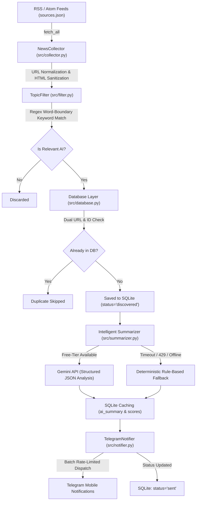

# 🚀 AI Pulse Agent

An autonomous, production-ready AI engineering intelligence monitoring agent that continuously tracks cutting-edge AI breakthroughs (LLMs, Agentic AI, research papers, framework releases, robotics, and developer tools), deduplicates across syndicated feeds in SQLite, performs structured summarization and impact evaluation via the Google Gemini API (Free Tier), and delivers real-time notifications to Telegram with zero-cost rule-based fallback guarantees.

---

## 📑 Table of Contents

- [Overview & Key Features](#-overview--key-features)
- [System Architecture](#-system-architecture)
- [Technology Stack](#-technology-stack)
- [Project Structure](#-project-structure)
- [Installation & Local Setup](#-installation--local-setup)
- [Configuration Guide (`.env`)](#-configuration-guide-env)
- [Telegram Bot Setup](#-telegram-bot-setup)
- [Google Gemini API Setup (Free Tier)](#-google-gemini-api-setup-free-tier)
- [Execution Modes & CLI Commands](#-execution-modes--cli-commands)
- [Single-Instance Cross-Process Lock](#-single-instance-cross-process-lock)
- [Gemini Retry Handling & Fallback Logic](#-gemini-retry-handling--fallback-logic)
- [SQLite Deduplication & State Tracking](#-sqlite-deduplication--state-tracking)
- [Running Automated Tests](#-running-automated-tests)
- [Deployment Options](#-deployment-options)
- [Limitations & Troubleshooting](#-limitations--troubleshooting)
- [License](#-license)

---

## 🌟 Overview & Key Features

AI Pulse Agent operates as an autonomous background pipeline designed for AI students, researchers, and engineers who want curated, high-signal AI news without information overload or cloud hosting costs:

- **Autonomous Background Polling**: Runs continuously on a configurable interval (default: 5 minutes or 30 minutes) with graceful OS-level signal handling (`SIGINT`, `SIGTERM`).
- **Multi-Source RSS Aggregation**: Parses Atom and RSS feeds across premier AI organizations (OpenAI, Google DeepMind, Google AI, Hugging Face, arXiv cs.AI/cs.LG, MIT Technology Review).
- **Regex Boundary Keyword Filtering**: Matches domain terms with strict word boundaries to eliminate false positives (e.g., matching `"rag"` without matching `"dragon"`).
- **Dual Persistent Deduplication**: Tracks both stable article identifiers and canonical URL hashes in SQLite to prevent syndication duplicates across cross-posting publishers.
- **Structured LLM Analysis (Free Tier Only)**: Uses Google GenAI (`gemini-3.8-flash`) to generate structured summaries, student-focused *"Why It Matters"* explanations, suggested next actions, and 1–10 importance/relevance scores.
- **Zero-Cost Offline Fallback**: If Gemini rate limits (HTTP 429), times out, or lacks an API key, the agent seamlessly switches to deterministic rule-based analysis without interrupting notification delivery.
- **Cross-Process Single-Instance Lock**: Prevents duplicate polling loops and duplicate notification dispatching via OS kernel file locks (`msvcrt` on Windows, `fcntl` on POSIX).
- **Rich Telegram Dispatch**: Formats news into Telegram HTML cards with category badges, rating indicators, and direct source links.

---

## 🏗️ System Architecture

### Pipeline Flow



---

## 💻 Technology Stack

| Component | Technology | Purpose |
| :--- | :--- | :--- |
| **Language** | Python 3.10+ | Core language runtime |
| **Data Modeling** | Pydantic v2 | Structured validation for articles and Gemini JSON |
| **Persistence** | SQLite3 with WAL | Local deduplication, metadata cache, and audit history |
| **Feed Ingestion** | Feedparser, Requests | RSS/Atom parsing and HTTP header sanitization |
| **AI Summarization** | Google GenAI SDK (`google-genai`) | Free-tier Gemini LLM structured extraction |
| **Notifications** | Telegram Bot API (HTTP) | Real-time push delivery to mobile and desktop |
| **Process Locking** | `msvcrt` (Win) / `fcntl` (POSIX) | OS-level cross-process mutual exclusion |
| **Testing** | Pytest, Pytest-Mock | 79 automated offline unit tests |

---

## 📁 Project Structure

```text
AI pulse/
├── app.py                  # CLI controller, argument parser & entrypoint
├── config.py               # Central environment configuration & defaults
├── sources.json            # Active feed list (URLs, categories, weights)
├── requirements.txt        # Production & testing dependencies
├── .env.example            # Safe environment template with dummy values
├── .gitignore              # Protection against secret and database leaks
├── README.md               # Architecture documentation & operations guide
├── data/                   # Runtime data directory (gitignored)
│   ├── ai_pulse.db         # Persistent SQLite database
│   └── agent.lock          # OS single-instance process lock
├── src/
│   ├── __init__.py
│   ├── models.py           # Pydantic schemas (Article, ArticleAnalysis)
│   ├── collector.py        # Feed parser, tracking-param scrubber, HTML clean
│   ├── filter.py           # Word-boundary keyword filter & scoring
│   ├── database.py         # SQLite connection pool, migrations, queries
│   ├── summarizer.py       # Gemini API client, retry backoff & fallback
│   ├── notifier.py         # Telegram HTML formatter & rate-limited client
│   └── agent.py            # Polling orchestrator & PollingLock guard
└── tests/
    ├── conftest.py         # Shared fixtures & offline network isolation
    ├── test_agent.py       # Cycle, safe first-run & deduplication tests
    ├── test_collector.py   # Feed parsing, URL normalization & error tests
    ├── test_database.py    # Schema migration, retry caps & stats tests
    ├── test_filter.py      # Keyword boundaries & relevance scoring tests
    ├── test_lock.py        # OS process locking & stale-lock recovery tests
    ├── test_notifier.py    # Telegram formatting, batching & rate limit tests
    └── test_summarizer.py  # Gemini retry, timeout, schema & fallback tests
```

---

## 🚀 Installation & Local Setup

### Prerequisites
- Python 3.10 or higher.
- Git.
- Free Telegram account.
- Free Google AI Studio API key (optional; fallback operates without it).

### Step 1: Clone Repository
```bash
git clone https://github.com/RNSNavadeep/ai-pulse.git
cd ai-pulse
```

### Step 2: Create and Activate Virtual Environment

**Windows (PowerShell):**
```powershell
python -m venv .venv
.\.venv\Scripts\Activate.ps1
```

**macOS / Linux:**
```bash
python3 -m venv .venv
source .venv/bin/activate
```

### Step 3: Install Dependencies
```bash
pip install --upgrade pip
pip install -r requirements.txt
```

### Step 4: Configure Environment Variables
Copy the template to create your local `.env`:
```bash
cp .env.example .env
```
Open `.env` and fill in your credentials (see next section).

---

## ⚙️ Configuration Guide (`.env`)

```env
# ==========================================
# 1. Telegram Bot Credentials
# ==========================================
TELEGRAM_BOT_TOKEN=123456789:ABCdefGhIJKlmNoPQRsTUVwxyZ_1234567
TELEGRAM_CHAT_ID=987654321

# ==========================================
# 2. Agent Polling & Delivery Limits
# ==========================================
POLL_INTERVAL_SECONDS=300
MAX_NOTIFICATIONS_PER_RUN=5
LOG_LEVEL=INFO

# ==========================================
# 3. Persistence & Fault Tolerance
# ==========================================
DB_NAME=ai_pulse.db
MAX_RETRIES=3
RETRY_BACKOFF_SECONDS=2.0
INITIAL_RUN_SEND_ALERTS=false

# ==========================================
# 4. Google Gemini LLM Integration (Free-Tier)
# ==========================================
GEMINI_API_KEY=AIzaSyYourSecretKeyHere
GEMINI_MODEL=gemini-3.8-flash
GEMINI_MAX_REQUESTS_PER_CYCLE=5
GEMINI_DAILY_LIMIT=100
LLM_ENABLED=true
GEMINI_REQUEST_TIMEOUT_MS=25000
GEMINI_MAX_SDK_RETRIES=0
```

---

## 📱 Telegram Bot Setup

1. Open Telegram and search for [@BotFather](https://t.me/BotFather).
2. Send `/newbot` and follow instructions to name your bot and choose a username.
3. Copy the HTTP API token provided by BotFather and paste it into `.env` as `TELEGRAM_BOT_TOKEN`.
4. Run the interactive auto-discovery tool:
   ```bash
   python app.py --setup-bot
   ```
5. Follow the on-screen prompt: open your new bot on Telegram and tap **START** (or send `"hello"`).
6. The CLI will automatically detect your Chat ID, write it into `.env`, and dispatch a test message to verify connectivity.

---

## 🧠 Google Gemini API Setup (Free Tier)

1. Navigate to [Google AI Studio](https://aistudio.google.com/app/apikey).
2. Sign in with any standard Google account.
3. Click **"Create API Key"**.
4. Paste the key into `.env` as `GEMINI_API_KEY`.
5. **Zero-Cost Guarantee**: The agent uses `gemini-3.8-flash`, which is available under the Google AI Studio Free Tier. It enforces a daily cap of 100 requests (well under the 1,500 RPD free limit).
6. **No Credit Card Required**: If the key is omitted or the quota is exhausted, the local rule-based fallback executes automatically.

---

## ⚡ Execution Modes & CLI Commands

### 1. View Current Database & Summary Statistics
Inspect article counts, delivery states, and summarization breakdowns:
```bash
python app.py --status
```

Output display:
```text
============================================================
📊 AI Pulse Agent - Database Status
============================================================
📁 Path:        C:\...\data\ai_pulse.db
📚 Total:       98 articles recorded
🆕 Discovered:  0 (awaiting alert)
⏳ Pending:     0 (in progress)
✅ Sent:        48 (delivered to Telegram)
❌ Failed:      0 (retry attempts remaining)
🚫 Ignored:     60 (excluded from all pipelines)
------------------------------------------------------------
🧠 Phase 4: Gemini LLM Summaries
   • Completed (AI Summaries): 10
   • Fallback (Rule-Based):    5
   • Insufficient Context:     2
   • Failed Summarization:     0
   ─ Pending breakdown (will NOT be re-processed) ─────────
   • Actionable (next cycle):  0  ← agent will summarize these
   • Historic (pre-Phase 4):   33  ← already sent, never re-summarized
   • Ignored (backlog-skipped):54  ← permanently excluded, never processed
============================================================
```

### 2. Run Single Cycle (Production Mode)
Fetches feeds, scores articles, enriches with Gemini, and delivers to Telegram:
```bash
python app.py --run-cycle
```

### 3. Dry-Run Cycle (No Notifications)
Collects, filters, enriches, and caches analysis in SQLite without sending Telegram alerts:
```bash
python app.py --run-cycle --dry-run
```

### 4. Continuous Autonomous Polling
Runs the continuous background monitoring agent:
```bash
python app.py --poll
```
To customize the interval (e.g. 30 minutes = 1800s):
```bash
python app.py --poll --interval 1800
```
*(Press `Ctrl+C` to cleanly exit and release the process lock).*

---

## 🔒 Single-Instance Cross-Process Lock

To prevent duplicate alerts when a background service or developer starts the agent multiple times, AI Pulse Agent employs an OS kernel file lock:

- **Windows**: `msvcrt.locking(fd, msvcrt.LK_NBLCK, 1)`
- **Linux / macOS**: `fcntl.flock(fd, fcntl.LOCK_EX | fcntl.LOCK_NB)`
- **Stale-Lock Immunity**: The lock is bound to the operating system's file table descriptor. If a process terminates or is killed with `kill -9`, the OS kernel immediately releases the byte lock.
- **Graceful Rejection**: If another instance attempts to run while the lock is held, it aborts immediately with an informative message without modifying or terminating the existing process:
  ```text
  ❌ AI Pulse Agent is already running (lock owner PID: 14820).
     Only one polling process may run at a time.
  ```

---

## 🛡️ Gemini Retry Handling & Fallback Logic

To balance high-quality summaries with strict protection against hung cycles or wasted quota:

1. **SDK Retries Disabled (`GEMINI_MAX_SDK_RETRIES=0`)**: Prevents hidden SDK-internal retries from compounding execution latency.
2. **Per-Call Timeout (`GEMINI_REQUEST_TIMEOUT_MS=25000`)**: Hard 25-second ceiling on every API call.
3. **Application Retry Ceiling**: At most **1 retry** (2 total attempts) with bounded exponential backoff ($2.0\text{s}$ initial, capped at $5.0\text{s}$).
4. **Permanent vs. Transient Error Classification**:
   - `400`, `401`, `403`, `404`, `permission_denied`: Aborts immediately on attempt 1 without retry.
   - `429` (Quota Reached): Flags cycle as quota-exhausted and immediately falls back.
   - `503`, `408`, timeout: Retried once, then falls back.
5. **Deterministic Rule-Based Fallback**: Generates keyword-aligned categories, relevance scores, and beginner-friendly summaries locally using the article's RSS snippet.

---

## 💾 SQLite Deduplication & State Tracking

Articles pass through explicit status transitions stored in SQLite (`data/ai_pulse.db`):

- `discovered`: Identified from an RSS feed as matching AI topics and queued for processing.
- `pending`: Locked in the current cycle for Gemini enrichment and Telegram dispatch.
- `sent`: Successfully delivered to Telegram.
- `failed`: Delivery failed (retried up to `MAX_RETRIES` times with exponential backoff).
- `ignored`: Archived historical backlog that is excluded from summarization and notifications.

**Stale Recovery**: If an unexpected crash occurs mid-dispatch, `recover_stale_pending()` automatically returns stuck `pending` articles back to `discovered` on the next reboot.

---

## 🧪 Running Automated Tests

The test suite runs 100% offline using mocked API boundaries and in-memory SQLite instances:

```bash
python -m pytest -v
```

Verification output:
```text
============================= test session starts =============================
collected 79 items

tests/test_agent.py ...........                                          [ 13%]
tests/test_collector.py .....                                           [ 20%]
tests/test_database.py .........                                         [ 31%]
tests/test_filter.py ...                                                 [ 35%]
tests/test_lock.py ....................                                  [ 60%]
tests/test_notifier.py .......                                           [ 69%]
tests/test_summarizer.py ........................                        [100%]

============================= 79 passed in 3.73s ==============================
```

---

## ☁️ Deployment Options

### Deployment Requirements
A production deployment of AI Pulse Agent requires:
1. Python 3.10+ execution environment.
2. Persistent file storage for `data/ai_pulse.db`.
3. Ability to run a persistent background process (`python app.py --poll --interval 1800`).
4. Outbound HTTPS access to RSS feeds, Telegram API (`api.telegram.org`), and Google Gemini API.

### Recommended Free Deployment Options

#### Option A: Self-Hosted / Home Server / Raspberry Pi (Recommended)
Because the agent uses SQLite and requires persistent background execution, running it on an always-on home server, mini PC, or Raspberry Pi is the most reliable zero-cost option.
- Create systemd service on Linux (`/etc/systemd/system/aipulse.service`):
  ```ini
  [Unit]
  Description=AI Pulse Agent Background Service
  After=network.target

  [Service]
  Type=simple
  User=ubuntu
  WorkingDirectory=/opt/ai-pulse
  ExecStart=/opt/ai-pulse/.venv/bin/python app.py --poll --interval 1800
  Restart=always
  RestartSec=30
  EnvironmentFile=/opt/ai-pulse/.env

  [Install]
  WantedBy=multi-user.target
  ```
  Enable and run:
  ```bash
  sudo systemctl daemon-reload
  sudo systemctl enable aipulse
  sudo systemctl start aipulse
  ```

#### Option B: Oracle Cloud Always Free VM
Oracle Cloud provides an Always Free ARM/x86 VM (Compute Instance) with persistent block storage:
- Provision an Always Free Ubuntu VM.
- Clone the repository and configure `.env`.
- Run the systemd service above for continuous operation.

#### Option C: Docker Container
Build and run anywhere with persistent volume mounting:
```bash
docker build -t ai-pulse-agent .
docker run -d \
  --name ai-pulse \
  --restart unless-stopped \
  -v $(pwd)/data:/app/data \
  --env-file .env \
  ai-pulse-agent
```

*(Note: Free ephemeral PaaS providers like Render free web services, Vercel, or Heroku free tier will either sleep web containers or wipe the SQLite database on redeploy. Use a persistent VM, VPS, or volume-backed container).*

---

## 🛠️ Limitations & Troubleshooting

1. **"AI Pulse Agent is already running"**:
   - An existing instance holds `data/agent.lock`. If you need to restart, terminate the active process with `Ctrl+C`.
2. **"Gemini API Free-Tier Quota Reached (HTTP 429)"**:
   - The agent automatically pauses Gemini API calls for the remainder of the cycle and transparently falls back to local rule-based analysis. No manual intervention is needed.
3. **Database Concurrency**:
   - SQLite with `timeout=15` handles safe write serialization. However, running multiple polling loops on the same database file from different servers is not supported; always run a single agent instance per database.

---

## 📄 License

This project is open-source under the [MIT License](LICENSE).
